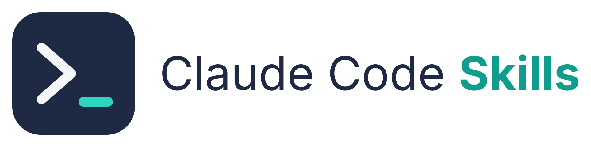

<p align="center">
  <a href="README.md">Español</a> | <b>English</b>
</p>

<h1 align="center">
  <picture>
    <source media="(prefers-color-scheme: dark)" srcset="assets/branding/claude-code-skills-logo-dark.png">
    
  </picture>
</h1>

<p align="center">
  Personal collection of skills for Claude Code.
</p>

<p align="center">
  <a href="LICENSE"></a>
</p>

## Description

A skill is a folder with a `SKILL.md` file that teaches Claude Code how to perform a specific task. Claude Code loads it when the task matches the skill's description.

This repository gathers the skills I use in my projects: some written by other authors and some written by me.

## Structure

```
claude-code-skills/
├── assets/branding/    # Logo
├── third-party/        # Skills by other authors
├── custom/             # Skills written by me
├── LICENSE
├── README.md
└── README.en.md
```

Each skill lives in its own folder:

```
skill-name/
├── SKILL.md            # Instructions (required)
└── ...                 # Supporting files used by the skill (optional)
```

## Skills

### Third-party

| Skill | Description |
|---|---|
| `grill-me` | Interviews you until your plan has no gaps |
| `to-prd` | Turns a conversation into a product requirements document |
| `to-issues` | Turns a plan into GitHub issues |
| `tdd` | Test-driven development |
| `triage-issue` | Finds the root cause of a bug |
| `git-guardrails-claude-code` | Blocks dangerous git commands |
| `write-a-skill` | Creates new skills with the correct structure |
| `setup-pre-commit` | Sets up Git pre-commit hooks |
| `improve-codebase-architecture` | Looks for architecture improvements in an existing project |
| `request-refactor-plan` | Creates a refactoring plan with small commits |

### Custom

| Skill | Description |
|---|---|
| `conventional-commit` | Writes commit messages in English following Conventional Commits |
| `pr-description` | Writes Pull Request titles and descriptions |
| `english-review` | Reviews technical English and explains each correction in Spanish |
| `prompt-engineer` | Designs and improves prompts for AI models |
| `ai-api-integrator` | Integrates the OpenAI, Anthropic or Gemini APIs |
| `agent-builder` | Creates autonomous agents that carry out tasks |
| `jarvis-memory` | Manages persistent memory for a personal assistant |

## Installation

Copy the folder of the skill you want into one of these locations:

- `.claude/skills/` inside a project, to use it only in that project.
- `~/.claude/skills/`, to use it in all projects.

## Acknowledgements

The skills in `third-party/` come from [mattpocock/skills](https://github.com/mattpocock/skills). All credit goes to the original author.

## Disclaimer

Personal project, not affiliated with Anthropic. Claude and Claude Code are trademarks of their respective owners.

## Author

Pablo Ubieto Foncillas ([@PabloUbieto](https://github.com/PabloUbieto)).

## License

The original content of this repository is released under the [MIT license](LICENSE). The skills in `third-party/` keep the license of their original author.
